# BriefForge Technical Architecture — AI vs. Deterministic Code

> **Audience:** Engineering Leads, System Architects, and Technical Evaluators  
> **Core Principle:** *Code does math, units, rules, and geometry. AI does reading, meaning, and wording. AI output is strictly validated against Pydantic schemas.*

---

## 1. End-to-End Architectural Pipeline Flowchart

```mermaid
flowchart TD
    subgraph Inputs["1. INGESTION"]
        DielinePDF["Dieline PDF Proof (Esko DeskPack/AI)"]
        ContentSheet["Content Sheet (XLSX Workbook)"]
        SpecDocs["Specs & Notes (DOCX, Plain PDF, TXT)"]
    end

    subgraph CodeExtract["2. CODE: GEOMETRIC & TEXT EXTRACTION"]
        PyMuPDF["PyMuPDF: Span & Trace Parsing (mm boxes, pt sizes)"]
        LetterSpacing["Code: Letter-Spacing & Arc Rebuild ('1 5 g' -> '15 g')"]
        FilterGuide["Code: Filter Guide Layers ('Art orientation', 'gl1')"]
        DetectHidden["Code: Z-Order Check (Flags covered EU table as 'hidden')"]
        OpenPyXL["openpyxl: Column A-C Parser + Cell Notes Linker"]
        DocxReader["python-docx: Paragraph & Line Indexer"]
    end

    subgraph AIExtract["3. AI: READING & SEMANTIC EXTRACTION"]
        CartonPrompt["AI (Gemini / Vision): Panel Text & Certified Marks Extraction"]
        SheetPrompt["AI (Gemini): Unstructured Rows & Note Intent Extraction"]
        PydanticValidate["Code: Pydantic Schema Validation (Strict JSON)"]
    end

    subgraph Verification["4. CODE: VERIFICATION & AUDIT"]
        RapidFuzz["Code (RapidFuzz): Fuzzy Quote Verification at Coordinates"]
        StateAssign["Code: Assign States (Confirmed vs. AI-Suggested vs. Missing)"]
        PintUnits["Code (Pint): Unit Conversions (g, kg, oz, kcal, kJ)"]
        ValueDiff["Code: Value Conflict Comparator (480g vs 16.9oz = OK)"]
        IngredientDiff["Code: Ingredient List Normalizer & Duplicate Spotter"]
    end

    subgraph AISemantic["5. AI: MEANING CONFLICTS"]
        MeaningPrompt["AI: Semantic Conflict Detection (Vegan mark vs. Honey/Cholesterol)"]
        FactGuard["Code: Fact-ID Citation Guard (Rejects ungrounded AI claims)"]
    end

    subgraph DeterministicEngine["6. CODE: MATH & RULE ENGINE"]
        NutritionMath["Code: Nutrition Math (4/4/9 Calorie check, % DV recalculation)"]
        BarcodeMath["Code: Modulo-10 Barcode Check Digit (UPC-A / EAN-13)"]
        RuleEngine["Code: YAML Market Pack Engine (US FDA / India FSSAI)"]
        RankingGraph["Code: Graph Ranking (Impact = Requirements Unlocked)"]
    end

    subgraph AIWording["7. AI: QUESTION & BRIEF SYNTHESIS"]
        QuestionPrompt["AI: Question Wording & Business Justification ('Why')"]
        BriefWriterPrompt["AI: Brief Section Writer (Sentences with Fact ID Citations)"]
    end

    subgraph CodeOutput["8. CODE: AUDIT, GEOMETRY & EXPORT"]
        BriefAudit["Code: Sentence Audit Engine (Regex + Fact ID Matcher)"]
        VioletUnderline["Code: Violet Underline on Unproven Text + Approval Gate"]
        ThreeJSFold["Code (Three.js): Hinge Graph, Caliper Offset, 3D Folding"]
        Exporters["Code: Print CSS PDF Export + JSON Acceptance Checklist"]
    end

    Inputs --> CodeExtract
    CodeExtract --> AIExtract
    AIExtract --> PydanticValidate
    PydanticValidate --> Verification
    Verification --> AISemantic
    AISemantic --> FactGuard
    FactGuard --> DeterministicEngine
    DeterministicEngine --> AIWording
    AIWording --> CodeOutput
```

---

## 2. Division of Responsibility: AI vs. Deterministic Code

| Pipeline Stage | Task | Engine | Source File | Why Code vs. AI? |
| :--- | :--- | :--- | :--- | :--- |
| **Ingestion** | PDF Text & Layer Extraction | **Code** | `backend/app/readers/pdf_reader.py` | Deterministic vector coordinates, font sizes, and drawing sequence numbers (`seqno`). Code guarantees exact bounding boxes. |
| **Ingestion** | Letter-Spacing & Arc Text Rebuild | **Code** | `backend/app/readers/pdf_reader.py` | Algorithmic reassembly of single-character glyphs along arcs (`PACKED WITH GOODNESS`) and wide letter-spacing (`1 5 g` $\to$ `15 g`). |
| **Ingestion** | Hidden Artwork Detection | **Code** | `backend/app/readers/pdf_reader.py` | Compares bounding box overlap with subsequent opaque fill shapes; prevents AI from hallucinating covered EU tables as active packaging copy. |
| **Reading** | Panel Copy & Visual Seal Recognition | **AI** | `backend/app/ai/prompts/extract_carton.v1.md` | Vision model reads graphic-only seals (Certified Vegan, USDA Organic) and parses messy unstructured packaging copy into clean structured schema fields. |
| **Verification** | Quote & Citation Corroboration | **Code** | `backend/app/analysis/quote_check.py` | RapidFuzz fuzzy string matching against exact text spans on that panel. If an AI quote does not match raw text at that location, it is downgraded to `ai_suggested`. |
| **Verification** | Unit Standardization | **Code** | `backend/app/analysis/units.py` | Python `Pint` library handles unit algebra ($480\text{ g} = 16.9\text{ oz}$; $1\text{ kcal} = 4.184\text{ kJ}$). AI is banned from unit conversion. |
| **Reconciliation** | Ingredient List Normalization | **Code** | `backend/app/analysis/reconcile.py` | Tokenizes ingredient strings, strips parentheticals, spots missing components (walnuts, flax) and duplicates (sunflower seeds). |
| **Reconciliation** | Semantic Meaning Contradictions | **AI** | `backend/app/ai/prompts/meaning_conflicts.v1.md` | Spots contextual contradictions (e.g., product claims "Suitable for Vegans" while formula contains Honey and declared cholesterol is 45 mg). |
| **Guardrail** | Fact Citation Guard | **Code** | `backend/app/analysis/reconcile.py` | Intercepts AI meaning conflict output; if the AI cites a fact ID that does not exist in the database, the output is discarded. |
| **Math** | Nutrition & Calorie Validation | **Code** | `backend/app/rules/nutrition_math.py` | $4\text{ kcal/g}$ (protein/carb) $+ 9\text{ kcal/g}$ (fat) checks printed calories (flags 166 kcal vs expected ~535 kcal); FDA % Daily Value recalculation. |
| **Math** | Barcode Checksum | **Code** | `backend/app/rules/barcode.py` | Standard Modulo-10 check digit calculation for UPC-A and EAN-13. |
| **Compliance** | Market Pack Rule Evaluation | **Code** | `backend/app/rules/engine.py` | Evaluates declarative YAML rules (`markets/us/*.yaml`) using boolean trees (`all`, `any`, `not`). Completely agnostic of country logic. |
| **Prioritization** | Question Ranking & DAG Ripple | **Code** | `backend/app/rules/questions.py` | Bipartite graph algorithm counts how many downstream requirements each question unlocks; ranks highest-impact first and caps at 10. |
| **Synthesis** | Question Phrasing & Rationale | **AI** | `backend/app/ai/prompts/question_wording.v2.md` | Transforms dry rule violations into concise, diplomatic business questions with a clear "Why". |
| **Deliverable** | Brief Generation | **AI** | `backend/app/ai/prompts/write_brief.v1.md` | Synthesizes approved facts into agency brief prose, tagging each sentence with the exact fact IDs it cites. |
| **Deliverable** | Sentence Audit Engine | **Code** | `backend/app/brief/audit.py` | Regex parser extracts every number, unit, and claim word from brief sentences; verifies each against cited fact IDs; flags unproven text. |
| **Geometry** | 3D Folding & Dieline Kinematics | **Code** | `frontend/src/three/geometry.ts` | Breadth-first hinge tree, transformation matrices, double-lid caliper offset (`INNER_INSET = 0.8 mm`), and 0° to 90° tuck-end kinematics. |
| **Copilot** | "Ask About This" Q&A | **AI** | `backend/app/ai/prompts/ask.v1.md` | Synthesizes natural language answers to user queries, strictly constrained to cite active project facts and rules. |

---

## 3. Technical Deep-Dive by Domain

### 3.1. Ingestion: Code Handles Geometry First
Before AI ever sees the files, Python code parses the structural vector dieline:
- **PyMuPDF Trace:** Extracts bounding boxes in millimetres (`mm`), font sizes in points (`pt`), and layer names (`Cut`, `Crease`, `Artwork Panels`, `Dimensions`).
- **Guide Filter:** Drops non-artwork text using regex and layer tags (`Art orientation`, `gl1`, `Copy free`).
- **Visual Occlusion Detection:** Reads drawing sequence numbers (`seqno`). If an opaque white polygon is drawn over text later in the drawing tree (such as the white box over the EU nutrition table), that text is assigned status `hidden` and quarantined so AI never treats it as live packaging copy.

### 3.2. Extraction: AI Reads, Code Validates
- Gemini parses each panel's text into structured JSON fields.
- **Strict Pydantic Contract:** The output is immediately validated against Pydantic schemas (`Fact`). If an LLM returns malformed JSON or invented attributes, it is rejected and retried with schema backoff.

### 3.3. Verification: Deterministic Code Polices AI
Every fact generated by AI must pass through two deterministic checks:
1. **RapidFuzz Quote Corroboration:** Code searches the raw document pieces at the specified location (`panel` or `sheet cell`). If the quote cannot be verified with $>85\%$ fuzzy similarity, the fact is downgraded from `confirmed` to `ai_suggested`.
2. **Pint Unit Normalization:** Values are parsed into normalized quantities (e.g. converting `16.9 oz` and `480 g` to standard grams). Comparisons are executed using exact numerical tolerances ($<0.01\%$), ensuring false alarms are never raised for valid dual-declaration quantities.

### 3.4. Semantic vs. Arithmetic Conflict Detection
- **Code catches Arithmetic Conflicts:** Barcode check digits, daily value percentages, calorie sums ($4\text{C} + 4\text{P} + 9\text{F}$), serving size divisions ($480\text{ g} / 8 = 60\text{ g} \neq 85\text{ g}$).
- **AI catches Meaning Conflicts:** Detects contextual contradictions that math cannot catch (e.g. *"Product claims Suitable for Vegans, but ingredient list includes Honey, and cholesterol is declared at 45 mg"*). 
- **The Fact Guard:** Code inspects the AI's meaning conflict response. If the AI hallucinates a contradiction citing non-existent fact IDs, the code rejects the output before it reaches the UI.

### 3.5. Output: Brief Synthesis & The Sentence Audit Engine
- **AI Drafts:** Gemini writes the natural-language sections of the brief, tagging each sentence with `factIds: ["f-honey-pct", "f-net-weight"]`.
- **Code Audits:** The `audit.py` engine pulls every numeric token, unit, and regulatory keyword from each sentence and verifies it against the cited facts:
  - If a user types *"Net weight is 500 g"* but the facts only corroborate $480\text{ g}$, the sentence audit fails, applies the violet underline in the UI, and locks the "Approve Brief" button.

