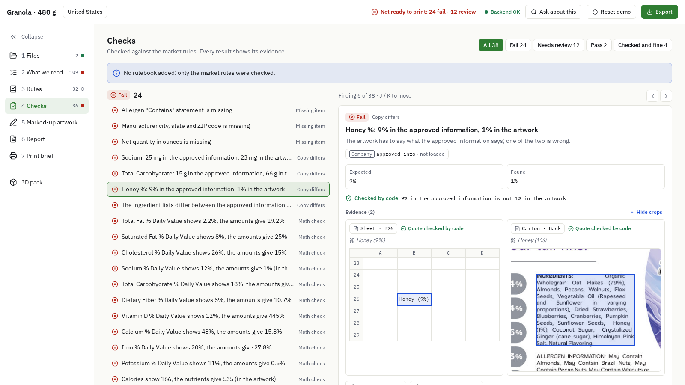
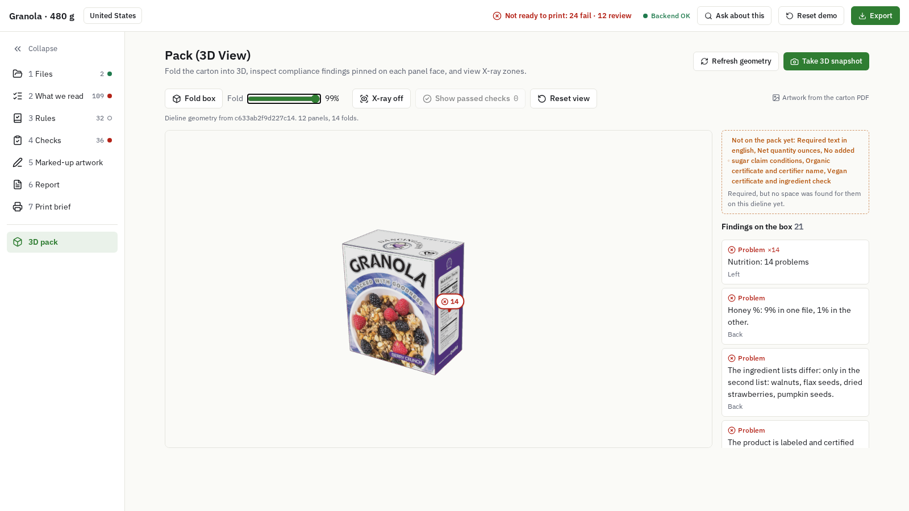
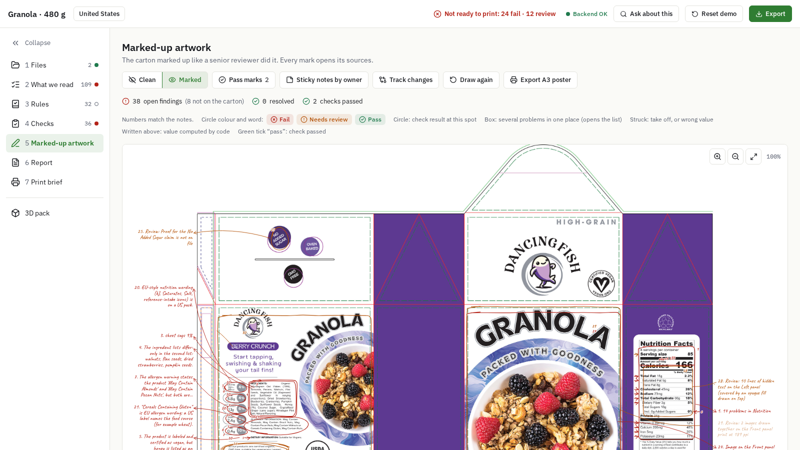
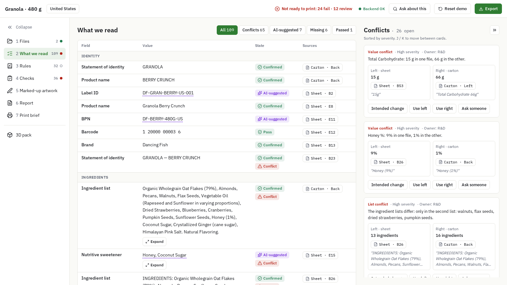
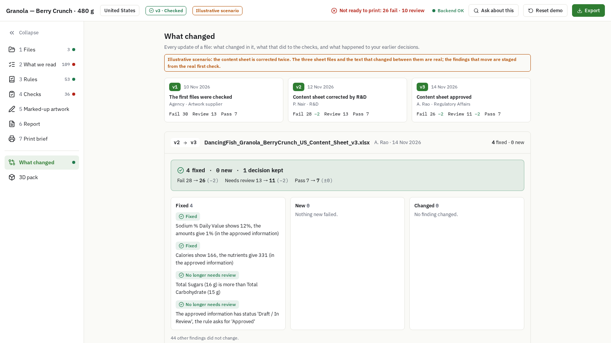
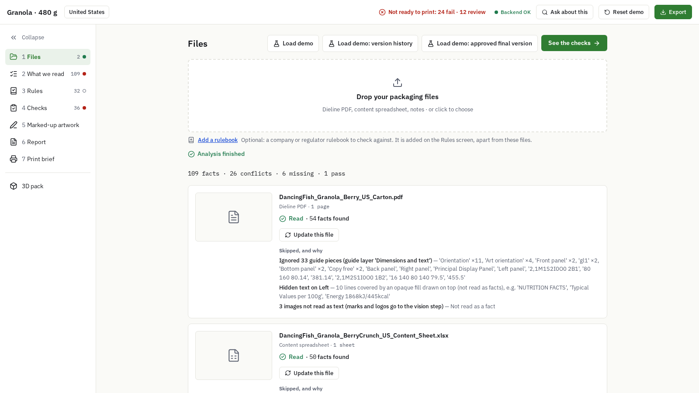
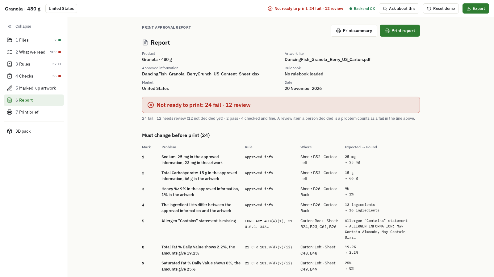

# BriefForge: is this packaging artwork ready to print?

An AI-assisted checker for finished packaging artwork (Esko AIForge hackathon, **Problem 2**). Give it the artwork, the approved product information and a rulebook. It tells you what is **wrong**, what **needs a person**, and what is **correct**, and shows the evidence for each one.

Built and demonstrated on Esko's sample files: the Dancing Fish Granola Berry Crunch US carton (dieline PDF) and its content sheet (Excel).

## What it does

- **Reads the artwork the way a printer does.** Every piece of text keeps its panel, page and position in mm. Dieline guide text ("Art orientation", "Copy free") is ignored, and text hidden under an opaque fill is detected instead of being read as copy. That is how it finds an old EU nutrition table covered by the US panel on the sample.
- **Compares the artwork with the approved product information.** It flags different values, ingredient lists that don't match, and items that are missing. It never flags a value that only looks different (480 g vs the same amount in ounces).
- **Checks the rules.** These are FDA rules for the US, kept as data in `markets/us/`, and the company's own rulebook (`rulebooks/`, 21 rules). The code does the maths: % Daily Values, calories from fat, carbohydrate and protein, the UPC check digit, and font sizes.
- **Sorts every result into three verdicts:**
  - **Fail:** the rule is cited and the evidence was checked by code.
  - **Needs review:** the result rests on AI judgement, or on evidence the artwork can't show, such as a certificate. A named person decides, and the decision is logged.
  - **Pass:** the rule is met, and the result says where.
- **Shows the evidence.** Each finding has the exact quote, a crop of the artwork or the spreadsheet cell, expected vs found, and the code's working ("15 g ÷ 78 g = 19.2%, printed 2.2%"). Marks are drawn on the real carton.
- **Exports a print-approval report** with every finding, the decisions, the rules used and a sign-off line.

## Why you can trust it

- **The AI reads, the code checks.** Every fact the AI extracts comes with a quote. The code confirms that the quote is really in the file, at that place. If it isn't, the fact is marked "AI-suggested" and can never cause a Fail.
- **A rule the AI reads from your rulebook is quote-checked too.** A rule the AI made up is never applied.
- **No country is hard-coded.** Each market is a folder of YAML (`markets/us`, `markets/in`), and the engine code contains no FDA values, units or currencies. A test enforces this.

## Quick start

You need [uv](https://docs.astral.sh/uv/) (it installs Python 3.12 for you) and Node 24.

```
npm install
npm install --prefix frontend
uv sync --directory backend
npm run dev            # backend on :8000, frontend on :5173
```

Open http://localhost:5173 and either:
- click **Load demo** to see the sample results instantly, with no AI calls; or
- go to **Files** and drop in `samples/DancingFish_Granola_Berry_US_Carton.pdf` and `samples/DancingFish_Granola_BerryCrunch_US_Content_Sheet.xlsx`.

Reading new files needs a free Google AI Studio key in `backend/.env`:

```
LLM_API_KEY=your-key-here
```

Never commit that file. It is ignored by git.

## The screens

1. **Files**: drop the artwork, the approved product information and (optionally) a rulebook.
2. **What we read**: every fact with its source, marked "checked by code" or "AI-suggested".
3. **Checks**: Fail / Needs review / Pass. Each card shows the rule, the evidence side by side and the proof. A person decides the review items here.
4. **Marked-up artwork**: the carton with a mark on every problem.
5. **Report**: the print-approval report, ready to print or save as PDF.
6. **3D pack**: the dieline folds into a 3D carton, with the findings pinned to the panel they are on.
7. **What changed**: update a file as a new version and see what changed, what that did to the checks, and what happened to earlier decisions. Only the changed cells or panels are sent to the AI again.

## Screenshots

Taken from the running app on the Dancing Fish sample files.

**Checks.** The honey conflict: 9% on the content sheet, 1% on the carton, with both quotes checked by code.



**3D pack.** The carton folded in 3D, with the findings pinned to the panel they are on.



**Marked-up artwork.** The carton marked up like a senior reviewer did it. Every mark opens its sources.



**What we read.** Every fact with its source, marked "checked by code" or "AI-suggested".



**What changed.** An updated file as a new version. This is an illustrative scenario: the three sheet files are real, and the findings that move between versions are staged from the real first check.



**Files** and **Report**





## Tests

```
npm test               # backend (pytest) and frontend (Vitest); never calls the network
npm run test:e2e       # Playwright, drives the real app with recorded AI responses
```

Tests replay recorded AI responses from `backend/tests/fixtures/ai/`, so they are free and give the same result every time. `npm run test:record` re-records them, which needs a key and uses quota.

Two answer keys keep the checker honest:
- `backend/tests/fixtures/answer_key.yaml` lists every known problem in Esko's sample files.
- `backend/tests/fixtures/rulebook_key.yaml` gives the expected verdict of every rule in our rulebook.

## Project layout

```
backend/     FastAPI app (Python 3.12): readers, extraction and quote check, rule engine, checks, API
frontend/    React + TypeScript (Vite, Tailwind)
markets/     market packs as data: us/ (FDA), in/ (FSSAI), company/
rulebooks/   our demo company rulebook (YAML source; .docx and .pdf built by backend/scripts/build_rulebook.py)
samples/     Esko's sample files
e2e/         Playwright specs
docs/        plan, phases and the parallel build plan (docs/archive: the earlier design-brief version)
```

## Limits

- **US first.** The India pack exists as data, but the market switch is not in the UI yet.
- **Text inside images is left to the vision model, so it is lower trust.** Certification marks on the sample are images, and findings about them are Needs review.
- **Checks that need evidence from outside the artwork stay Needs review,** such as a certificate on file or a clear area for the date code.
- **Some mistakes can't be caught.** A wrong sentence with no number, unit or claim word in it is not caught, and neither is a fact the AI never extracted.

## Status

Work in progress for the 22 October 2026 deadline. The current plan is in `docs/PHASES.md` ("Problem 2 pivot") and `docs/PARALLEL_PLAN.md`. The project began as a design-brief tool (Problem 1) and changed to Problem 2 on 20 October. The brief code is still in the repo but not in the app.
